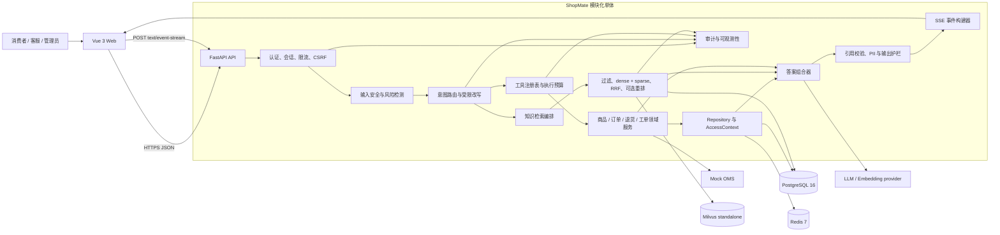
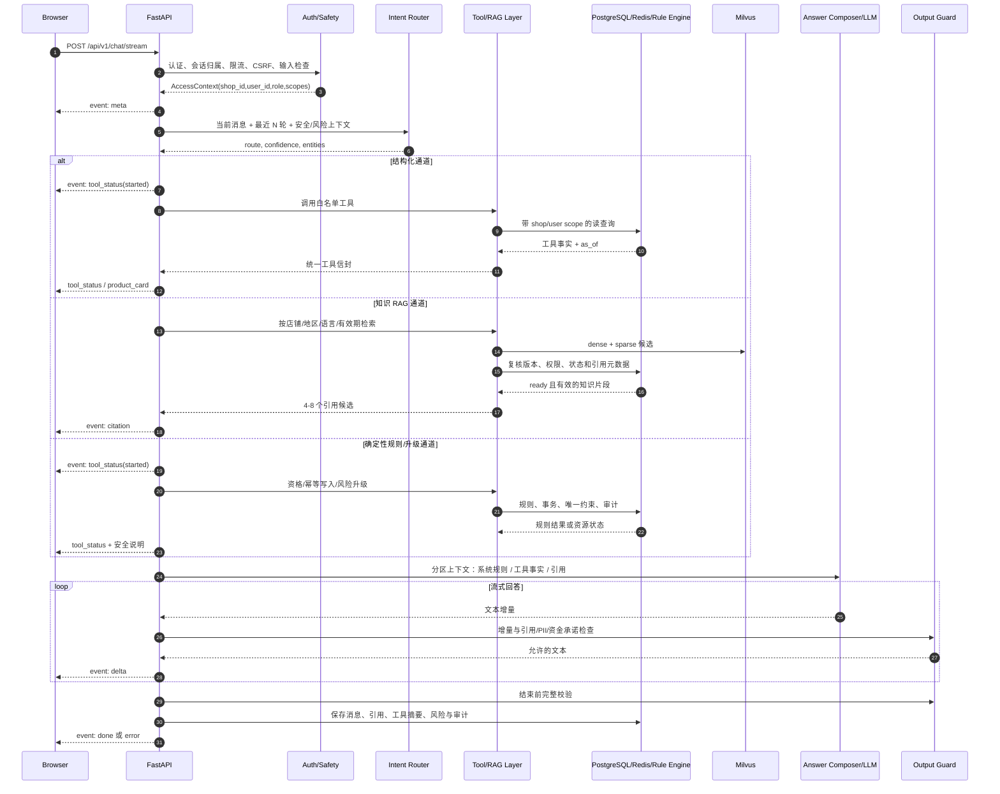

# ShopMate 架构设计

> 阶段：阶段 3 — 架构、数据契约、工具契约与 API 契约  
> 版本：v1.0  
> 日期：2026-10-18  
> 状态：阶段 3 契约稿；不代表任何业务功能已经实现  
> 上游依据：`AGENTS.md`、`docs/02-prd.md`、`docs/07-security.md`

## 1. 目标、约束与非目标

ShopMate 采用**模块化单体 + 单 Agent + 确定性工具层**。架构的第一目标不是让模型自由回答，而是保证：

1. 价格、库存、SKU、订单、物流和优惠只来自受控结构化数据源。
2. 政策回答只基于当前有效、店铺/地区/语言匹配的知识片段，并附可追溯引用。
3. 退货资格、退款边界、转人工和高风险升级由确定性规则决定。
4. 所有用户资源查询和写入均在服务端校验 `shop_id`、认证用户和资源归属。
5. 写入幂等、可审计；失败时明确拒答、澄清或转人工，不猜测事实。

本阶段不定义业务实现代码、容器配置或数据库迁移；这些分别留给阶段 4 及后续阶段。

## 2. 系统组件图

组件边界：

| 组件 | 职责 | 禁止事项 |
|---|---|---|
| API 路由 | HTTP/SSE 协议转换、认证依赖、稳定错误映射 | 直接写 SQL、直接决定退款/工单状态 |
| 安全护栏 | 长度、PII、注入、高风险和输出事实检查 | 只依赖前端或只依赖 LLM 分类 |
| 路由与改写 | 10 类意图分类、保留实体、有限历史补全 | 让检索文档决定工具权限 |
| 工具注册表 | 固定白名单、schema、权限、预算、审计 | 动态 URL、任意 SQL、模型传入身份字段 |
| 领域服务 | 商品、订单、退货、工单业务与状态机 | 绕过 `shop_id`/`user_id` 查询 |
| RAG | 版本化知识检索、融合、引用生成 | 回答实时价格、库存、订单或物流 |
| 答案组合器 | 在系统规则、工具事实、不可信引用之间组装上下文 | 把工具事实写成模型自由参数 |
| SSE 构建器 | 生成稳定、可测试的后端事件 | 让模型原始文本决定事件类型或字段 |
| PostgreSQL | 业务事实、知识元数据、会话、审计 | 存浮点金额、无时区时间或明文密钥 |
| Redis | 限流、短期会话、受控缓存、验证码 | 长期缓存实时事实或高风险回答 |
| Milvus | dense/sparse 检索向量与可过滤元数据 | 成为权限或事实的最终事实源 |
| Mock OMS | 合成订单/物流状态边界 | 连接真实支付、退款或承运商 |

## 3. 部署与信任边界

本地部署由 `web`、`api`、PostgreSQL、Redis、etcd、MinIO、Milvus 组成，全部通过 Compose 启动；前端只调用公开 API。具体镜像与端口在阶段 4 固定。

信任边界如下：

1. 浏览器、用户文本、上传文件、模型输出和检索片段都不可信。
2. JWT、角色、`shop_id`、`user_id` 和内部审计字段只由后端认证/上下文注入。
3. Milvus/PG 中的知识元数据在返回前再次校验店铺、地区、语言、版本和有效期。
4. 模型与工具之间只传递注册表允许的字段；模型不能访问数据库、Redis、Milvus 或任意 URL。
5. SSE 只传输后端验证后的稳定结构；模型增量文本只能进入 `delta.data.text`。

## 4. 一次聊天请求时序

关键顺序：

1. 认证、会话归属、限流和输入检查先于路由与任何工具调用。
2. 高风险规则先于普通意图分类；高风险时不继续生成退款或赔偿承诺。
3. 工具调用顺序固定为：schema -> 身份/店铺 -> 资源归属 -> 业务状态 -> 数据操作。
4. 政策片段先由 Milvus 召回，再由 PostgreSQL 权威元数据复核；最终引用必须来自实际提供的片段。
5. 每次写工具通过幂等记录和数据库唯一约束保证重试不重复创建。
6. 流结束时只发送一个终止事件：`done` 或 `error`。

## 5. 三条核心路径

### 5.1 路径 A：结构化购物与订单

适用意图：商品发现、详情、比较、价格/库存/优惠、订单状态、物流。

执行步骤：

1. 从 `AccessContext` 取 `shop_id`、认证用户、角色和允许范围。
2. 路由提取实体：商品 ID、variant ID、预算整数分、订单号、SKU、时间等。
3. 工具层只调用 `search_products`、`get_product_detail`、`compare_products`、`check_stock`、`get_promotion`、`get_order_status` 或 `get_shipment`。
4. Repository 强制带店铺范围；订单、物流、退货资源再带用户归属条件。
5. 输出事实带 `source` 和 `as_of`；订单/物流还带 `status_updated_at` 或节点时间。
6. 工具失败时返回“当前无法确认”；不得用历史消息或知识片段补全。

商品搜索由 PostgreSQL 受控过滤和排序完成；Redis 只能短期缓存相同查询结果并保留 `as_of`。RAG 中的商品说明只能解释用途和属性，不能提供价格、SKU、库存或优惠事实。

### 5.2 路径 B：文档知识 RAG

适用意图：退换货政策、保修、发票、配送、活动规则、FAQ、商品说明书。

执行步骤：

1. 对问题做有限历史改写，保留订单号、商品 ID、SKU、金额、日期和地区。
2. 构造强制过滤条件：`shop_id`、知识库、`locale`、`region`、`ready`、当前时间在 `[effective_from, effective_to)` 内。
3. 用 BGE-M3 一次前向生成查询的 dense(1024, 已归一化) 与 sparse 权重，并行执行两路检索，各取 top 30；任一路失败即返回错误，不降级为单路。
4. 使用 RRF 融合排名，不直接相加不同量纲的原始分数。
5. 按片段、父块、文档版本去重；用 PostgreSQL 权威元数据再次过滤过期、停用和跨店铺结果。
6. 可选 reranker 重排；基线默认关闭，开启状态写入检索审计。
7. 选择 4-8 个适合 token 预算的片段，为每个片段生成稳定 `citation_id`。
8. 答案组合器只能引用本轮实际提供的片段；输出前执行引用和证据校验。
9. 无证据、低支持度或冲突时澄清/拒答/转人工，不生成看似完整的条款。

实现要点（阶段 7）：

- 过滤分两层：Milvus 表达式做租户/地区/语言/生效期预过滤，融合后再用 PostgreSQL 元数据（文档状态、版本 `parse_status`、片段 `is_enabled`/软删除、有效期）做权威复核；被剔除的候选在审计里按原因计数（`expired`、`cross_shop`、`version_not_ready` 等）。
- 证据门槛使用**最佳片段的 dense 余弦相似度**（`POLICY_MIN_EVIDENCE_SIMILARITY`），不是 RRF 分数；RRF 只用于排序。门槛未通过时返回固定拒答文案，不调用回答模型。
- 任一检索支路失败会抛出带错误码的异常（`DENSE_BRANCH_FAILED` / `SPARSE_BRANCH_FAILED` / `HYBRID_SEARCH_FAILED`），并在审计中记录支路状态；不存在静默 dense-only 降级。dense-only 只作为评测消融模式（`dense_only_ablation`）存在。
- 回答校验是确定性的：模型只能引用本轮实际提供的 `[cN]`；出现未标注引用的政策句、未知编号或缺失引用时，整段回答降级为转人工，未校验草稿不返回给用户。

详细策略见 `docs/adr/0002-rag-retrieval-strategy.md`。

### 5.3 路径 C：确定性规则与升级

适用意图：退货资格、创建退货申请、投诉/法律/人身安全、异常订单、低置信度、工具失败或用户要求人工。

执行步骤：

1. 风险引擎先识别法律/监管、人身安全、隐私泄露、账号被盗、投诉、资金承诺和人工请求。
2. 退货先调用资格的只读规则；输入不足时澄清，不调用写工具。
3. 规则返回 `eligible`、`ineligible`、`needs_clarification` 或 `needs_manual_review`，并给出稳定 `decision_code`、命中规则、是否可创建申请、是否需要工单以及材料与下一步。
4. 只有用户明确确认且资格在有效期内时，才可调用 `create_return_request`；只写 `submitted`。
5. 退款流程与退货申请分离；LLM 无权读写退款审批，也不得声称退款成功。
6. 任一高风险触发条件成立时调用 `create_handoff_ticket`；资金承诺语句被输出护栏阻断。
7. 写请求使用幂等键；同一作用域重复请求返回同一资源或稳定冲突错误。

确定性规则的精确条件见 `docs/05-tool-contract.md` 第 7 节。

## 6. 意图路由与执行预算

| 意图 | 主路径 | 允许工具/能力 | 默认回退 |
|---|---|---|---|
| `product_discovery` | A | `search_products` | 澄清预算/类目 |
| `product_compare` | A | `compare_products` | 要求选择 2-4 个商品 |
| `product_fact` | A | `get_product_detail`、`check_stock`、`get_promotion` | 无法确认 |
| `policy_faq` | B | RAG | 澄清/拒答/人工 |
| `order_status` | A | `get_order_status` | 无法确认/人工 |
| `shipment` | A | `get_shipment`，必要时先查订单 | 无法确认/人工 |
| `return_eligibility` | C | `check_return_eligibility` | 澄清/人工 |
| `return_request` | C | 资格检查 -> 明确确认 -> 创建申请 | 不写库/人工 |
| `complaint_handoff` | C | `create_handoff_ticket` | 直接人工 |
| `smalltalk_or_unknown` | 安全回退 | 无实时事实工具 | 澄清或有限 FAQ |

路由规则：

1. 安全/高风险检测优先。
2. 带商品、SKU、订单号、金额等实时事实实体的问题优先进入 A，不因词面命中政策而进入 RAG。
3. 分类不足时先澄清；涉及权益或无法澄清时转人工。
4. 单轮最多 4 次工具调用；同一工具连续失败 2 次立即停止并升级或明确无法确认。
5. 最多 2 次检索执行、最多 3 个子查询；所有改写记录原问题、策略、实体和结果。
6. `INTENT_MIN_CONFIDENCE` 初始配置为 `0.70`；低于该值不得执行写工具。该值是工程基线，不是效果宣传或已校准指标。

## 7. 数据一致性、事务与幂等

1. 写工具在一个数据库事务内创建业务记录、幂等记录和审计事件；任一必需步骤失败则回滚。
2. `idempotency_records` 对 `(shop_id, actor_user_id, operation, idempotency_key)` 建唯一约束；`actor_user_id` 是实际发起写入的人，不等于被查询或处理的目标用户。
3. 相同键和相同请求摘要返回原结果并标记 `idempotent_replay=true`；相同键不同摘要返回 `IDEMPOTENCY_CONFLICT`。
4. 并发重复请求由唯一约束仲裁，只有一个请求可创建资源。相同请求重放复用原业务资源和原 `tool_call_id`，不新增 `tool_calls` 记录；幂等重放本身另写审计事件。
5. 退货申请、退款流程、人工工单使用分离状态；`approved` 不代表退款成功。
6. 知识新版本不覆盖旧版本；重建索引产生新版本或新 ingestion job。
7. 用户消息在请求接受时写入。助手流式内容先在受控内存/Redis 缓冲，在 `done`、`error` 或断线终止时一次性写入 `messages`，避免修改已落库正文。正常终稿 `is_complete=true`；断线后保存的部分快照 `is_complete=false`，不把半截回答当作正常完成。

## 8. 缓存策略

| 数据 | 存储 | TTL/失效 | 约束 |
|---|---|---|---|
| 验证码、限流 | Redis | 短 TTL | 不写日志明文 |
| 商品/库存/优惠短缓存 | Redis | 秒级至分钟级，配置化 | 必带 `as_of`，失效后回源 |
| 订单/物流实时事实 | Redis 可选 | 极短 TTL | 不使用长期 FAQ 缓存 |
| FAQ 高置信答案 | Redis | 版本化 TTL | key 含 shop/region/locale/KB/knowledge version |
| 低置信、冲突、高风险、资金/投诉 | 不缓存 | 不适用 | 必须重新执行安全和证据校验 |

知识版本、生效期、停用状态变化时，主动失效对应 FAQ 缓存。缓存命中仍执行权限、引用和输出护栏。

## 9. 可观测性与审计

结构化日志至少包含：`request_id`、`trace_id`、`conversation_id`（必要时哈希）、路由、意图、工具名、状态、错误码、`latency_ms`、检索耗时、候选数、引用 ID、版本 ID、token 用量和风险类别。

禁止记录完整 prompt、完整文档、完整用户输入、JWT、密钥、SQL、连接串或完整 PII。工具调用、权限拒绝、风险升级、幂等重放、知识状态变更和回答质量标记均写审计事件。

## 10. 故障降级

| 故障 | 用户可见行为 | 禁止行为 |
|---|---|---|
| PostgreSQL 不可用 | 实时事实和写入不可确认；可转人工 | 模型猜价格/订单/库存 |
| Redis 不可用 | 回源或降级限流策略；不影响事实来源 | 把缓存当唯一事实 |
| Milvus 不可用 | 政策明确“当前知识库无法检索” | 用模型记忆回答政策 |
| Mock OMS 失败 | `UPSTREAM_UNAVAILABLE` 和人工路径 | 推断已发货/已送达 |
| LLM 超时 | 保留已验证结构信息，返回可重试错误 | 把未完成文本标为成功 |
| 连续工具失败 | 停止调用，给出下一步/人工 | 无限重试 |
| SSE 中断 | 前端显示未完成提示；恢复后读取历史 | 自动无限重连或把半截内容当完成 |

## 11. 质量门禁与验收映射

| 架构项 | 后续证据 |
|---|---|
| 三通道边界 | 路由单元测试和 E2E 旅程 |
| 订单归属 | 跨用户/跨店铺安全测试 |
| 政策引用 | 无证据、过期、冲突和恶意文档测试 |
| 幂等写 | 并发重复请求与数据库唯一约束测试 |
| 金额/时间 | 类型测试、边界测试和 API schema 校验 |
| SSE | 固定事件 fixture、断线/错误/取消测试 |
| 降级 | 依赖故障注入测试 |

本文件定义的是目标架构，只有后续测试、数据库迁移和运行证据才能证明实现符合预期。
