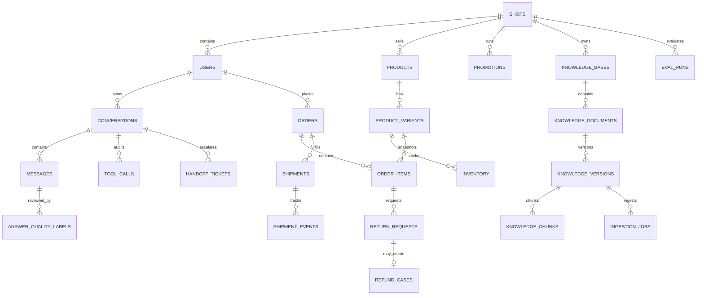

# ShopMate 数据契约

> 阶段：阶段 3 — 架构、数据契约、工具契约与 API 契约  
> 版本：v1.0  
> 日期：2026-10-18  
> 数据库：PostgreSQL 16  
> 状态：逻辑数据契约；实际表由后续 Alembic 迁移创建，不代表已经实现

## 1. 通用规则

1. 主键为 UUID；时间字段为 `TIMESTAMPTZ`，只存 UTC 瞬时，API 输出使用 ISO 8601 UTC（以 `Z` 结尾）。
2. 金额一律使用 `BIGINT *_cents` 加 `CHAR(3) currency`，禁止 `FLOAT`、`REAL`、`DOUBLE` 或字符串金额参与计算。
3. 所有业务表带 `created_at`、`updated_at`；除审计/不可变记录外，更新时由服务层维护 `updated_at`。
4. 所有租户资源带 `shop_id`。用户资源同时带 `user_id` 或 `owner_user_id`。每次请求的 Repository 都必须接收并应用 `AccessContext(shop_id, actor_user_id, effective_user_id, role, scopes)`。
5. 消费者业务查询必须同时满足店铺范围和用户归属条件；目录等店铺共享数据的查询仍必须绑定认证用户与店铺上下文，并在审计中记录请求者。
6. 资源软删除使用 `deleted_at`；订单、知识版本、消息、工具审计不能物理删除。会话、文档、片段按业务采用软删除/停用。
7. 合成数据显式标记 `is_synthetic=true`；Mock OMS 数据标记 `source_system='mock_oms'`。
8. `locale` 采用 BCP 47（如 `zh-CN`），`region` 采用 ISO 3166-1 alpha-2（如 `CN`），币种为大写 ISO 4217。
9. JSONB 只保存受控扩展字段；不保存身份授权、任意 SQL、完整 PII 或密钥。
10. 所有枚举在数据库层和 Pydantic schema 中同时校验；非法状态转换由领域服务拒绝。

## 2. 逻辑关系图



## 3. 核心表与字段

### 3.1 店铺、用户与认证

#### `shops`

| 字段 | 类型 | 约束/说明 |
|---|---|---|
| `id` | UUID | PK |
| `name` | VARCHAR(120) | NOT NULL |
| `locale` | VARCHAR(16) | NOT NULL，默认 `zh-CN` |
| `currency` | CHAR(3) | NOT NULL，默认 `CNY` |
| `timezone` | VARCHAR(64) | NOT NULL，默认 `Asia/Shanghai`，仅用于展示 |
| `is_synthetic` | BOOLEAN | NOT NULL，默认 true |
| `created_at`, `updated_at` | TIMESTAMPTZ | NOT NULL |

#### `users`

| 字段 | 类型 | 约束/说明 |
|---|---|---|
| `id` | UUID | PK |
| `shop_id` | UUID | FK -> `shops(id)`；NOT NULL |
| `email_ci` | VARCHAR(320) | 合成测试域名；同店铺唯一 |
| `password_hash` | TEXT | Argon2 哈希；禁止明文 |
| `role` | ENUM `user_role` | `shopper/support/admin` |
| `display_name_masked` | VARCHAR(120) | 可空；不存完整真实姓名 |
| `is_active` | BOOLEAN | NOT NULL，默认 true |
| `is_synthetic` | BOOLEAN | NOT NULL，默认 true |
| `last_login_at` | TIMESTAMPTZ | 可空 |
| `created_at`, `updated_at` | TIMESTAMPTZ | NOT NULL |

#### `refresh_sessions`

| 字段 | 类型 | 约束/说明 |
|---|---|---|
| `id` | UUID | PK |
| `shop_id`, `user_id` | UUID | FK -> `shops/users` |
| `token_hash` | BYTEA | 只存 refresh token 哈希，唯一 |
| `expires_at`, `last_used_at`, `revoked_at` | TIMESTAMPTZ | 轮换、撤销和重放检测 |
| `created_at`, `updated_at` | TIMESTAMPTZ | NOT NULL |

### 3.2 会话、消息与工具审计

#### `conversations`

| 字段 | 类型 | 约束/说明 |
|---|---|---|
| `id` | UUID | PK |
| `shop_id`, `user_id` | UUID | 归属用户与店铺 |
| `title` | VARCHAR(120) | NOT NULL |
| `deleted_at` | TIMESTAMPTZ | 软删除 |
| `created_at`, `updated_at` | TIMESTAMPTZ | NOT NULL |

#### `messages`

| 字段 | 类型 | 约束/说明 |
|---|---|---|
| `id` | UUID | PK |
| `shop_id`, `conversation_id`, `user_id` | UUID | `user_id` 为会话所有者 |
| `role` | ENUM `message_role` | `user/assistant/system_event` |
| `content` | TEXT | 消息正文；MVP 仅 synthetic/受控输入 |
| `content_hash` | BYTEA | SHA-256，用于审计与去重，不替代原文 |
| `client_message_id` | UUID | 可空；用户消息幂等键 |
| `route`, `finish_reason` | VARCHAR(40) | 路由与 `stop/refusal/handoff/cancelled` |
| `citations_jsonb` | JSONB | 引用 ID 与已校验元数据摘要 |
| `risk_jsonb` | JSONB | 风险类别、等级、规则码，不含 PII |
| `is_complete` | BOOLEAN | 正常终稿为 true；断线后保存的部分快照为 false |
| `created_at`, `updated_at` | TIMESTAMPTZ | NOT NULL；助手消息只在终止时插入一次，正文及状态落库后不可修改，初始化时 `updated_at=created_at` |

#### `tool_calls`

| 字段 | 类型 | 约束/说明 |
|---|---|---|
| `id` | UUID | PK |
| `request_id`, `trace_id` | UUID | 请求/追踪关联 |
| `shop_id`, `conversation_id`, `user_id`, `actor_user_id` | UUID | `user_id` 为会话所有者/目标用户；`actor_user_id` 为实际调用者 |
| `tool_name` | VARCHAR(80) | 必须属于注册表白名单 |
| `input_redacted_jsonb` | JSONB | 脱敏参数，不含 PII/密钥 |
| `result_summary_jsonb` | JSONB | 最小化结果摘要 |
| `status` | ENUM `tool_call_status` | `started/succeeded/failed` |
| `error_code` | VARCHAR(64) | 可空 |
| `latency_ms` | INTEGER | 非负 |
| `idempotency_key` | VARCHAR(128) | 写工具关联，可空；非空时同店同调用者同工具的 key 唯一 |
| `created_at`, `updated_at` | TIMESTAMPTZ | NOT NULL |

#### `idempotency_records`

| 字段 | 类型 | 约束/说明 |
|---|---|---|
| `id` | UUID | PK |
| `shop_id`, `actor_user_id` | UUID | 幂等作用域；表示实际发起写入的操作者 |
| `operation` | VARCHAR(80) | 如 `create_return_request` |
| `idempotency_key` | VARCHAR(128) | 客户端/服务端稳定键 |
| `request_hash` | BYTEA | 规范化业务参数摘要 |
| `status` | ENUM `idempotency_status` | `processing/succeeded/failed` |
| `resource_type`, `resource_id` | VARCHAR(64)/UUID | 成功后关联资源 |
| `response_snapshot_jsonb` | JSONB | 可重放的最小安全响应 |
| `created_at`, `updated_at`, `expires_at` | TIMESTAMPTZ | 幂等记录保留期可配置 |

### 3.3 商品与优惠

#### `products`

| 字段 | 类型 | 约束/说明 |
|---|---|---|
| `id` | UUID | PK |
| `shop_id` | UUID | 租户范围 |
| `title` | VARCHAR(240) | NOT NULL |
| `description` | TEXT | 商品说明；不能提供实时价格 |
| `brand` | VARCHAR(120) | 可空 |
| `category` | VARCHAR(120) | 受控类目 |
| `attributes_jsonb` | JSONB | 受控键值；未知字段不推断 |
| `status` | ENUM `product_status` | `draft/active/archived` |
| `is_synthetic` | BOOLEAN | NOT NULL，默认 true |
| `created_at`, `updated_at`, `deleted_at` | TIMESTAMPTZ | 软删除 |

#### `product_variants`

| 字段 | 类型 | 约束/说明 |
|---|---|---|
| `id` | UUID | PK |
| `shop_id`, `product_id` | UUID | 所属店铺/商品 |
| `sku` | VARCHAR(80) | 同店铺唯一 |
| `title` | VARCHAR(240) | NOT NULL |
| `attributes_jsonb` | JSONB | 变体属性 |
| `price_cents` | BIGINT | NOT NULL，CHECK >= 0 |
| `currency` | CHAR(3) | NOT NULL |
| `status` | ENUM `variant_status` | `active/inactive/discontinued` |
| `is_synthetic` | BOOLEAN | NOT NULL，默认 true |
| `created_at`, `updated_at`, `deleted_at` | TIMESTAMPTZ | 软删除 |

#### `inventory`

| 字段 | 类型 | 约束/说明 |
|---|---|---|
| `id` | UUID | PK |
| `shop_id`, `variant_id` | UUID | 所属店铺/变体 |
| `warehouse_code` | VARCHAR(40) | 同变体+仓唯一 |
| `available_qty` | INTEGER | CHECK >= 0 |
| `reserved_qty` | INTEGER | CHECK >= 0 |
| `source_system` | VARCHAR(32) | `postgres/mock_oms` |
| `is_synthetic` | BOOLEAN | NOT NULL |
| `created_at`, `updated_at` | TIMESTAMPTZ | `updated_at` 是库存 `as_of` 依据 |

#### `promotions`

| 字段 | 类型 | 约束/说明 |
|---|---|---|
| `id` | UUID | PK |
| `shop_id` | UUID | 租户范围 |
| `name` | VARCHAR(160) | NOT NULL |
| `rule_jsonb` | JSONB | 受控门槛、优惠类型，不存任意表达式 |
| `starts_at`, `ends_at` | TIMESTAMPTZ | `starts_at < ends_at` |
| `status` | ENUM `promotion_status` | `draft/scheduled/active/ended/cancelled` |
| `is_synthetic` | BOOLEAN | NOT NULL |
| `created_at`, `updated_at` | TIMESTAMPTZ | NOT NULL |

### 3.4 订单、物流与售后

#### `orders`

| 字段 | 类型 | 约束/说明 |
|---|---|---|
| `id` | UUID | PK |
| `shop_id`, `user_id` | UUID | 必须与认证用户/店铺匹配 |
| `order_no` | VARCHAR(40) | 同店铺唯一；合成编号 |
| `status` | ENUM `order_status` | 见状态机 |
| `total_cents` | BIGINT | CHECK >= 0 |
| `currency` | CHAR(3) | NOT NULL |
| `placed_at`, `delivered_at`, `cancelled_at` | TIMESTAMPTZ | 可空，按状态约束 |
| `shipping_address_masked` | VARCHAR(240) | 只存脱敏展示值 |
| `source_system` | VARCHAR(32) | MVP 为 `mock_oms/postgres` |
| `is_synthetic` | BOOLEAN | NOT NULL |
| `created_at`, `updated_at` | TIMESTAMPTZ | NOT NULL |

#### `order_items`

| 字段 | 类型 | 约束/说明 |
|---|---|---|
| `id` | UUID | PK |
| `shop_id`, `order_id` | UUID | 所属店铺/订单 |
| `variant_id` | UUID | 可空以保留已下架商品快照 |
| `sku_snapshot` | VARCHAR(80) | 下单时 SKU |
| `title_snapshot` | VARCHAR(240) | 下单时标题 |
| `category_snapshot` | VARCHAR(120) | 规则使用 |
| `is_returnable_snapshot` | BOOLEAN | 规则使用 |
| `quantity` | INTEGER | CHECK > 0 |
| `unit_price_cents` | BIGINT | CHECK >= 0 |
| `line_total_cents` | BIGINT | CHECK >= 0 |
| `status` | ENUM `order_item_status` | `active/cancelled/returned` |
| `delivered_at` | TIMESTAMPTZ | 签收时间；退货窗口依据 |
| `created_at`, `updated_at` | TIMESTAMPTZ | NOT NULL |

#### `shipments`

| 字段 | 类型 | 约束/说明 |
|---|---|---|
| `id` | UUID | PK |
| `shop_id`, `order_id` | UUID | 所属店铺/订单 |
| `carrier` | VARCHAR(80) | 合成承运商 |
| `tracking_no_masked` | VARCHAR(80) | 只存脱敏值 |
| `tracking_no_hash` | BYTEA | 需要精确关联时使用 |
| `status` | ENUM `shipment_status` | 见状态机 |
| `shipped_at`, `estimated_delivery_at`, `delivered_at` | TIMESTAMPTZ | 可空 |
| `source_system` | VARCHAR(32) | MVP 为 `mock_oms` |
| `is_synthetic` | BOOLEAN | NOT NULL |
| `created_at`, `updated_at` | TIMESTAMPTZ | `updated_at` 是物流 `as_of` 依据 |

#### `shipment_events`

| 字段 | 类型 | 约束/说明 |
|---|---|---|
| `id` | UUID | PK |
| `shop_id`, `shipment_id` | UUID | 所属店铺/物流单 |
| `sequence_no` | INTEGER | 同物流单唯一递增 |
| `status` | ENUM `shipment_status` | 当前节点状态 |
| `description` | VARCHAR(240) | 合成、安全描述 |
| `occurred_at` | TIMESTAMPTZ | 节点时间 |
| `created_at`, `updated_at` | TIMESTAMPTZ | NOT NULL；不可变记录初始化后禁止普通更新 |

#### `return_requests`

| 字段 | 类型 | 约束/说明 |
|---|---|---|
| `id` | UUID | PK |
| `shop_id`, `user_id`, `order_id`, `order_item_id` | UUID | 必须指向同一用户订单项 |
| `reason_code` | ENUM `return_reason_code` | 见规则契约 |
| `status` | ENUM `return_status` | 工具只能创建 `submitted` |
| `requested_at`, `submitted_at`, `decided_at` | TIMESTAMPTZ | `submitted_at` 是工具成功写入时间；`decided_at` 可空 |
| `decision_reason` | VARCHAR(240) | 安全规则/人工摘要 |
| `required_materials_jsonb` | JSONB | 材料清单 |
| `is_synthetic` | BOOLEAN | NOT NULL |
| `created_at`, `updated_at` | TIMESTAMPTZ | NOT NULL |

同一订单项只能有一个状态为 `submitted/under_review/approved` 的有效申请，不区分 `reason_code`；由 partial unique index 保证。

#### `refund_cases`

| 字段 | 类型 | 约束/说明 |
|---|---|---|
| `id` | UUID | PK |
| `shop_id`, `user_id`, `return_request_id` | UUID | 一一关联退货申请 |
| `status` | ENUM `refund_status` | `pending_review/approved_synthetic/rejected/completed_synthetic` |
| `amount_cents` | BIGINT | CHECK >= 0 |
| `currency` | CHAR(3) | NOT NULL |
| `decision_actor_role` | VARCHAR(20) | 只能是 `support/admin/rule_engine` |
| `decision_reason` | VARCHAR(240) | 可审计原因 |
| `decided_at`, `completed_at` | TIMESTAMPTZ | 可空 |
| `created_at`, `updated_at` | TIMESTAMPTZ | NOT NULL |

`refund_cases` 只表达 synthetic/mock 审核状态，不表示真实资金到账；LLM 没有写权限。MVP 的 10 个工具和公开 API 不提供退款审批写接口；`support/admin/rule_engine` 字段仅保留给后续单独评审的确定性/人工流程。

#### `handoff_tickets`

| 字段 | 类型 | 约束/说明 |
|---|---|---|
| `id` | UUID | PK |
| `shop_id`, `conversation_id`, `user_id` | UUID | 会话所有者与范围 |
| `risk_level` | ENUM `risk_level` | `low/medium/high/critical` |
| `primary_reason_code` | VARCHAR(80) | 主风险规则码，必须属于规范风险码枚举 |
| `risk_rule_codes_jsonb` | JSONB | 全部命中的规范风险规则码数组，必须包含 `primary_reason_code` |
| `summary_redacted` | TEXT | 客服可用摘要，不含完整 PII |
| `status` | ENUM `handoff_status` | `open/assigned/resolved/closed` |
| `priority` | INTEGER | CHECK 1-5；同一规则确定 |
| `assigned_to` | UUID | 可空，support/admin 用户 |
| `idempotency_key` | VARCHAR(128) | 写入审计关联 |
| `is_synthetic` | BOOLEAN | NOT NULL，默认 true |
| `resolved_at`, `created_at`, `updated_at` | TIMESTAMPTZ | `resolved_at` 可空 |

### 3.5 知识、评测与客服反馈

#### `knowledge_bases`

| 字段 | 类型 | 约束/说明 |
|---|---|---|
| `id` | UUID | PK |
| `shop_id` | UUID | 租户范围 |
| `name` | VARCHAR(160) | 同店铺唯一 |
| `locale`, `region` | VARCHAR/DEFAULT | 默认知识适用范围 |
| `status` | ENUM `knowledge_base_status` | `active/archived` |
| `created_at`, `updated_at` | TIMESTAMPTZ | NOT NULL |

#### `knowledge_documents`

| 字段 | 类型 | 约束/说明 |
|---|---|---|
| `id` | UUID | PK |
| `shop_id`, `knowledge_base_id` | UUID | 必须同店铺 |
| `title` | VARCHAR(240) | NOT NULL |
| `doc_type` | ENUM `knowledge_doc_type` | `policy/faq/manual/warranty/invoice/shipping/other` |
| `locale`, `region` | VARCHAR | 检索过滤 |
| `status` | ENUM `knowledge_document_status` | `draft/active/archived` |
| `current_version_id` | UUID | 可空；必须属于本文档 |
| `is_synthetic` | BOOLEAN | NOT NULL |
| `created_at`, `updated_at`, `deleted_at` | TIMESTAMPTZ | 软删除 |

#### `knowledge_versions`

| 字段 | 类型 | 约束/说明 |
|---|---|---|
| `id` | UUID | PK |
| `shop_id`, `document_id` | UUID | 所属店铺/文档 |
| `version` | VARCHAR(40) | 同文档唯一，如 `2026.10.1` |
| `source_uri` | TEXT | 项目受控相对路径或对象键，不含任意 URL |
| `source_filename` | VARCHAR(240) | 重命名后的安全文件名 |
| `mime_type` | VARCHAR(120) | 实际检测值 |
| `content_hash` | BYTEA | 原文件 SHA-256 |
| `effective_from`, `effective_to` | TIMESTAMPTZ | 左闭右开；`effective_to` 可空 |
| `parse_status` | ENUM `parse_status` | `pending/processing/ready/failed/withdrawn` |
| `failure_code`, `failure_message_safe` | VARCHAR/ TEXT | 失败时安全原因 |
| `created_by` | UUID | 上传者 |
| `created_at`, `updated_at` | TIMESTAMPTZ | NOT NULL |

#### `knowledge_chunks`

| 字段 | 类型 | 约束/说明 |
|---|---|---|
| `id` | UUID | PK，与 Milvus `chunk_id` 一致 |
| `shop_id`, `knowledge_base_id`, `document_id`, `version_id` | UUID | 全部为强制过滤字段 |
| `parent_id` | UUID | 可空，父块/子块关系 |
| `chunk_index` | INTEGER | 同版本唯一，CHECK >= 0 |
| `heading_path` | TEXT[] | 标题路径 |
| `page_no` | INTEGER | 可空，CHECK > 0 |
| `text` | TEXT | 片段正文，视为不可信数据 |
| `content_hash` | BYTEA | 片段哈希 |
| `token_count` | INTEGER | CHECK >= 0 |
| `is_enabled` | BOOLEAN | false 时不参与检索 |
| `metadata_jsonb` | JSONB | 受控元数据，不放 PII；阶段 7 起必须含 `embedding: {model, dimension, revision, fingerprint}`，用于重导入比对与审计 |
| `created_at`, `updated_at`, `deleted_at` | TIMESTAMPTZ | 停用/删除 |

#### `ingestion_jobs`

| 字段 | 类型 | 约束/说明 |
|---|---|---|
| `id` | UUID | PK |
| `shop_id`, `version_id` | UUID | 所属范围 |
| `status` | ENUM `ingestion_status` | `queued/running/succeeded/failed` |
| `attempt_count` | INTEGER | 有上限 |
| `error_code`, `error_message_safe` | VARCHAR/TEXT | 安全错误 |
| `started_at`, `finished_at`, `created_at`, `updated_at` | TIMESTAMPTZ | 可空/必须 |

#### `eval_runs`

| 字段 | 类型 | 约束/说明 |
|---|---|---|
| `id` | UUID | PK |
| `shop_id` | UUID | 店铺范围 |
| `dataset_name`, `dataset_version` | VARCHAR(120) | 固定数据集版本 |
| `config_jsonb` | JSONB | 模型、检索参数、seed；不含密钥 |
| `status` | ENUM `eval_status` | `queued/running/succeeded/failed` |
| `metrics_jsonb` | JSONB | 可空，原始结果引用/汇总 |
| `created_by` | UUID | admin 用户 |
| `is_synthetic` | BOOLEAN | NOT NULL，默认 true；评测 fixture 不得混入真实 PII |
| `started_at`, `finished_at`, `created_at`, `updated_at` | TIMESTAMPTZ | 可空/必须 |

#### `answer_quality_labels`

| 字段 | 类型 | 约束/说明 |
|---|---|---|
| `id` | UUID | PK |
| `shop_id`, `message_id`, `conversation_id`, `labeled_by` | UUID | 目标助手消息与授权客服/管理员 |
| `label` | ENUM `answer_quality_label` | `correct/incorrect/needs_knowledge` |
| `reason_summary` | VARCHAR(240) | 可空安全摘要 |
| `request_id`, `audit_id` | UUID | 关联请求和审计 |
| `created_at`, `updated_at` | TIMESTAMPTZ | NOT NULL；不可变记录初始化后禁止普通更新 |

#### `audit_events`

| 字段 | 类型 | 约束/说明 |
|---|---|---|
| `id` | UUID | PK |
| `shop_id` | UUID | 租户范围 |
| `actor_user_id` | UUID | 可空，系统操作时为系统主体 |
| `actor_role` | VARCHAR(20) | 调用者角色 |
| `action` | VARCHAR(80) | 固定动作码 |
| `resource_type`, `resource_id` | VARCHAR/TEXT | 目标资源 |
| `request_id`, `trace_id` | UUID | 请求关联 |
| `outcome` | VARCHAR(20) | `success/denied/failed` |
| `risk_level` | ENUM `risk_level` | 可空 |
| `metadata_redacted_jsonb` | JSONB | 脱敏最小审计信息 |
| `occurred_at`, `created_at`, `updated_at` | TIMESTAMPTZ | NOT NULL；不可变审计记录禁止普通更新 |

## 4. 关键约束与复合外键

下列约束是租户/用户边界的数据层最后一道保护：

1. `(shop_id, id)` 在所有可被跨表引用的父表上唯一，子表使用复合 FK，防止跨店铺拼接。
2. `orders` 增加 `UNIQUE (shop_id, id, user_id)`；物流、订单项和退货引用时绑定同一店铺与用户。
3. `conversations` 增加 `UNIQUE (shop_id, id, user_id)`；消息、工具调用、工单引用时绑定同一所有者。
4. `order_items` 增加 `UNIQUE (shop_id, id, order_id)`；退货申请必须同时匹配 `shop_id/order_id/order_item_id/user_id`。
5. 所有金额字段：`CHECK (amount_cents >= 0)`；`currency ~ '^[A-Z]{3}$'`。
6. 数量字段：库存 `CHECK >= 0`；订单/退货数量 `CHECK > 0`。
7. 时间窗口：`effective_to IS NULL OR effective_to > effective_from`；`ends_at > starts_at`。
8. JSONB 只允许白名单键；任何授权判断不得依赖 JSONB 中的用户可写值。
9. 身份字段不可由 API/tool payload 覆盖；`shop_id/user_id` 来自服务端 `AccessContext`。
10. `handoff_tickets.risk_rule_codes_jsonb` 必须是规范风险规则码的非空数组，且包含 `primary_reason_code`；任何非规范风险码不得写入数据库。
11. `tool_calls` 非空 `idempotency_key` 在 `(shop_id, actor_user_id, tool_name, idempotency_key)` 上唯一；相同幂等请求重放不得插入第二条调用记录。

## 5. 索引目录

| 索引 | 表/列 | 目的 |
|---|---|---|
| `uq_users_shop_email` | `users(shop_id, lower(email_ci))` | 店铺内登录唯一 |
| `ix_users_shop_role_active` | `users(shop_id, role) WHERE is_active` | RBAC 查询 |
| `uq_refresh_token_hash` | `refresh_sessions(token_hash)` | 刷新令牌唯一 |
| `ix_conversations_shop_user_updated` | `conversations(shop_id, user_id, updated_at DESC) WHERE deleted_at IS NULL` | 会话列表 |
| `uq_messages_client` | `messages(shop_id, conversation_id, client_message_id)` where non-null | 聊天消息幂等 |
| `ix_messages_conversation_created` | `messages(shop_id, conversation_id, created_at)` | 历史消息 |
| `ix_tool_calls_conversation_created` | `tool_calls(shop_id, conversation_id, created_at)` | 工具审计 |
| `ix_tool_calls_tool_status` | `tool_calls(shop_id, tool_name, status, created_at)` | 失败率/连续失败 |
| `uq_tool_calls_idempotency` | `tool_calls(shop_id, actor_user_id, tool_name, idempotency_key) WHERE idempotency_key IS NOT NULL` | 每次逻辑写操作只保留一条工具调用 |
| `uq_idempotency_scope` | `idempotency_records(shop_id, actor_user_id, operation, idempotency_key)` | 写操作幂等 |
| `ix_products_shop_status_category` | `products(shop_id, status, category) WHERE deleted_at IS NULL` | 受控目录搜索 |
| `ix_products_title_trgm` | `products USING gin (title gin_trgm_ops)` | 标题子串搜索 |
| `uq_variants_shop_sku` | `product_variants(shop_id, sku)` | SKU 唯一 |
| `ix_variants_product_status` | `product_variants(shop_id, product_id, status)` | 商品详情 |
| `uq_inventory_variant_warehouse` | `inventory(shop_id, variant_id, warehouse_code)` | 仓库存唯一 |
| `ix_inventory_variant_updated` | `inventory(shop_id, variant_id, updated_at DESC)` | 库存查询/as_of |
| `ix_promotions_shop_time` | `promotions(shop_id, status, starts_at, ends_at)` | 当前优惠 |
| `uq_orders_shop_order_no` | `orders(shop_id, order_no)` | 订单号查询 |
| `ix_orders_shop_user_placed` | `orders(shop_id, user_id, placed_at DESC)` | 用户订单列表 |
| `ix_order_items_order` | `order_items(shop_id, order_id)` | 订单明细 |
| `ix_order_items_user_window` | `order_items(shop_id, delivered_at)` | 退货窗口批次 |
| `ix_shipments_order_updated` | `shipments(shop_id, order_id, updated_at DESC)` | 物流查询 |
| `uq_shipment_events_seq` | `shipment_events(shop_id, shipment_id, sequence_no)` | 节点顺序 |
| `uq_return_active_item` | `return_requests(shop_id, order_item_id) WHERE status IN ('submitted','under_review','approved')` | 防止重复有效申请 |
| `ux_refund_return_once` | `refund_cases(shop_id, return_request_id)` | 一申请一退款案例 |
| `ix_handoff_queue` | `handoff_tickets(shop_id, status, risk_level, created_at)` | 客服队列 |
| `ix_handoff_user` | `handoff_tickets(shop_id, user_id, created_at DESC)` | 用户工单 |
| `uq_knowledge_base_name` | `knowledge_bases(shop_id, name)` | 知识库名称 |
| `ix_documents_scope` | `knowledge_documents(shop_id, knowledge_base_id, status) WHERE deleted_at IS NULL` | 文档管理 |
| `uq_versions_document_version` | `knowledge_versions(shop_id, document_id, version)` | 版本唯一 |
| `ix_versions_effective` | `knowledge_versions(shop_id, parse_status, effective_from, effective_to)` | 有效版本过滤 |
| `uq_chunks_version_index` | `knowledge_chunks(shop_id, version_id, chunk_index)` | 片段顺序 |
| `ix_chunks_retrieval_scope` | `knowledge_chunks(shop_id, knowledge_base_id, version_id) WHERE is_enabled AND deleted_at IS NULL` | 检索复核 |
| `ix_ingestion_status` | `ingestion_jobs(shop_id, status, created_at)` | 任务监控 |
| `ix_eval_runs_shop_created` | `eval_runs(shop_id, created_at DESC)` | 评测历史 |
| `ix_labels_message` | `answer_quality_labels(shop_id, message_id, created_at DESC)` | 客服反馈 |
| `ix_audit_shop_time` | `audit_events(shop_id, occurred_at DESC)` | 审计检索 |
| `ix_audit_request` | `audit_events(request_id, trace_id)` | 请求追踪 |

`pg_trgm` 只用于受控标题/品牌子串搜索；品牌、类目、状态、预算和库存必须由参数化查询和白名单字段表达，禁止拼接任意 SQL。若后续引入全文检索，迁移和索引必须单独评审。

## 6. 状态机

### 6.1 订单

```text
created -> paid -> processing -> shipped -> delivered -> completed
created|paid|processing -> cancelled
```

- 只允许上述转换；`shipped`、`delivered`、`completed` 不得取消。
- 订单金额、状态和物流事实只能由受控订单/OMS 服务更新。
- LLM 和聊天工具没有订单状态写权限。

### 6.2 退货申请

```text
draft -> submitted -> under_review -> approved -> completed
                           \-> rejected
submitted/under_review -> cancelled
```

- `create_return_request` 只能创建 `submitted`。
- `approved` 仍不等于退款到账；退款状态必须在 `refund_cases` 独立存在。
- 重复有效申请由 partial unique index 阻止。

### 6.3 退款案例

```text
pending_review -> approved_synthetic -> completed_synthetic
               \-> rejected
```

- 只有确定性规则或授权人工可推进；LLM 无权调用写接口。
- `*_synthetic` 明确表示 mock，不代表真实资金流。

### 6.4 人工工单

```text
open -> assigned -> resolved -> closed
```

- `create_handoff_ticket` 只能创建 `open`。
- `assigned/resolved/closed` 由授权 support/admin 服务更新并审计。

### 6.5 物流

```text
pending -> picked_up -> in_transit -> out_for_delivery -> delivered
any non-terminal -> exception
exception -> in_transit|out_for_delivery|delivered
```

节点时间不可早于上一节点；Mock OMS 只能生成受控状态。

### 6.6 知识与 ingestion

```text
version.parse_status:
pending -> processing -> ready -> withdrawn
                       \-> failed

ingestion_job.status:
queued -> running -> succeeded
                  \-> failed
```

- 只有 `ready`、`is_enabled=true`、未删除且当前有效的版本参与检索。
- 重新上传生成新版本，不能覆盖旧版本。
- `failed` 不得生成可见知识库内容。

### 6.7 工具调用与评测

```text
tool_calls.status: started -> succeeded | failed
eval_runs.status: queued -> running -> succeeded | failed
```

## 7. 租户、用户与角色权限边界

### 7.1 AccessContext

每次认证请求构造不可变上下文：

```text
AccessContext {
  actor_user_id,
  effective_user_id,
  shop_id,
  role,
  permissions,
  request_id,
  trace_id
}
```

- `actor_user_id` 是发起人；消费者场景中 `effective_user_id == actor_user_id`。
- support 查看工单关联会话时，`effective_user_id` 从已授权会话/工单派生，不能由请求体指定。
- admin 的知识操作仍带 `shop_id`；admin 不自动拥有查看其他店铺用户订单的权力。
- 工具 schema 不暴露上述身份字段；service 层从上下文补齐。

### 7.2 角色矩阵

| 资源 | shopper | support | admin |
|---|---|---|---|
| 自己的会话/消息 | R/W | 通过授权工单查看关联会话 | 默认无权限；仅持 `support:conversation:read` 时查看授权工单关联会话 |
| 商品/库存/优惠 | R | R | R/W（管理导入） |
| 自己的订单/物流 | R | 通过授权工单查看脱敏摘要 | 不默认开放 |
| 退货资格/申请 | R/W（本人） | 无直接申请 API；仅授权工单详情可展示已存在的安全摘要，不审批退款 | 无直接申请 API；无运行时规则配置 API |
| 自己的工单 | R | 授权店铺队列 R/W | 授权店铺 R |
| 知识库/文档/片段 | 无权 | 只读引用摘要 | R/W（本店） |
| 评测 | 无权 | 无权或受限只读 | R/W（本店） |
| 回答质量标记 | 无权 | W（授权消息） | W（授权消息） |
| 审计 | 无权 | 仅授权工单详情中的工具/风险摘要 | 当前无独立审计 API；未来导出需单独权限 |

补充权限口径：

- support 查看会话必须有授权工单作为业务理由，不得列出、搜索或普通浏览消费者会话。
- admin 默认只管理本店知识、文档、片段、评测和审计摘要；只有显式获得 `support:conversation:read` 后，才可读取授权工单关联会话。
- support 角色默认拥有 `support:ticket:read/write`、`support:conversation:read` 和 `support:quality_label:write`；admin 需要逐项显式授予这些客服权限，单凭 admin 角色不能自动获得。
- 当前 MVP 的公开 API 不提供退款审批、退货人工审核或运行时规则配置。未来增加这些入口前，必须先扩展 API、权限、状态机和审计契约。

### 7.3 越权响应

对订单、物流、退货、工单和会话：

1. 资源不存在、属于他人或跨店铺均返回同一安全错误（`ORDER_NOT_FOUND`、`FORBIDDEN` 或稳定等价码），不暴露资源存在性。
2. Repository 条件必须同时包含 `shop_id` 和用户/角色范围；不能只查 ID 后再在应用层判断。
3. 写入前在同一事务内重新读取资源并验证归属，防止 TOCTOU。
4. 权限拒绝写 `audit_events`，审计中不放资源敏感内容。
5. 前端隐藏按钮不是权限控制。

## 8. 数据生命周期与保留

- `messages`、`tool_calls`、`handoff_tickets`、`audit_events` 保留供审计；删除会话只设置 `deleted_at`。
- 知识旧版本保留；停用使用 `withdrawn/is_enabled=false/deleted_at`。
- 订单、物流、退货、退款记录不物理删除。
- 幂等记录和刷新令牌按配置保留；过期后可归档，不能破坏审计关联。
- PII 在 MVP 中应为合成数据；若未来接入真实数据，必须完成单独隐私评审、加密和保留策略后才能实现。

## 9. 数据契约验收

1. 所有金额字段无浮点类型，API 用整数分。
2. 所有时间字段为 UTC、无时区丢失；API 输出 `Z`。
3. 跨店铺复合 FK 和用户归属复合 FK 在迁移测试中验证。
4. 订单、退货、退款、工单、物流、知识和工具状态机均有非法转换测试。
5. 有效退货申请并发插入只产生一条。
6. `shop_id/user_id` 不能来自模型或客户端敏感 payload。
7. 过期待用知识版本、停用片段和跨店铺片段不会进入检索。
